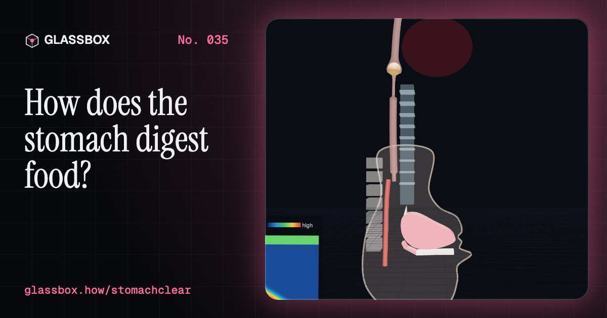
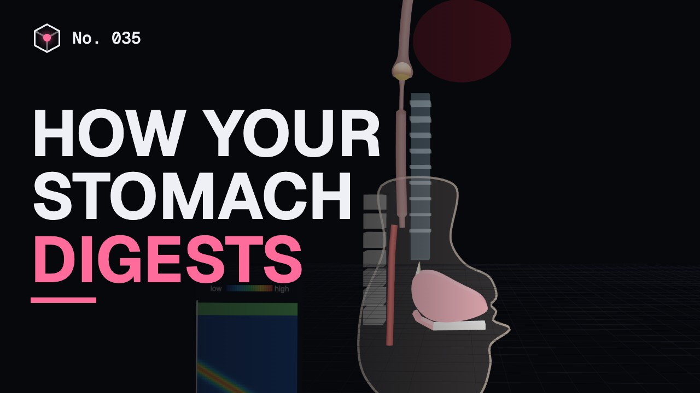
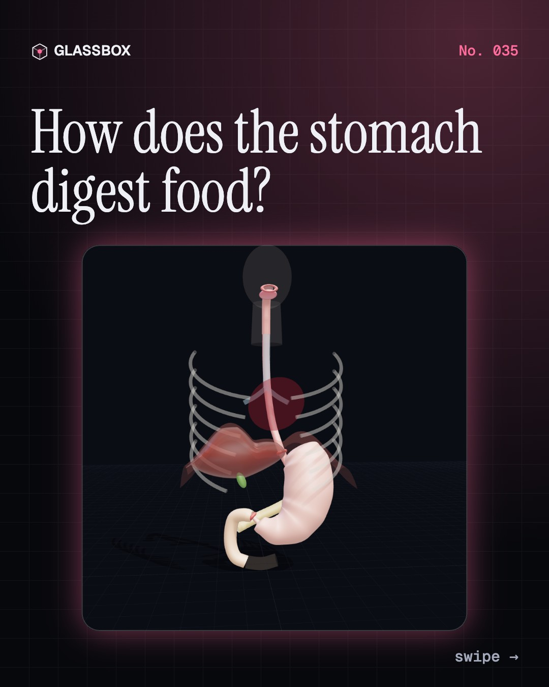
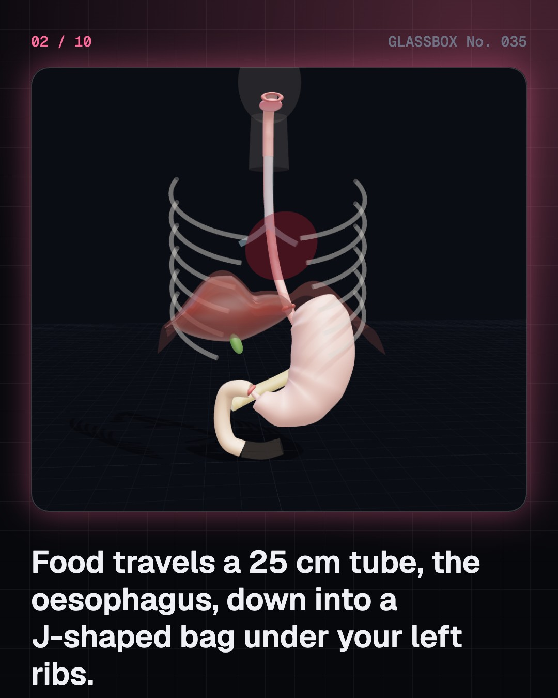
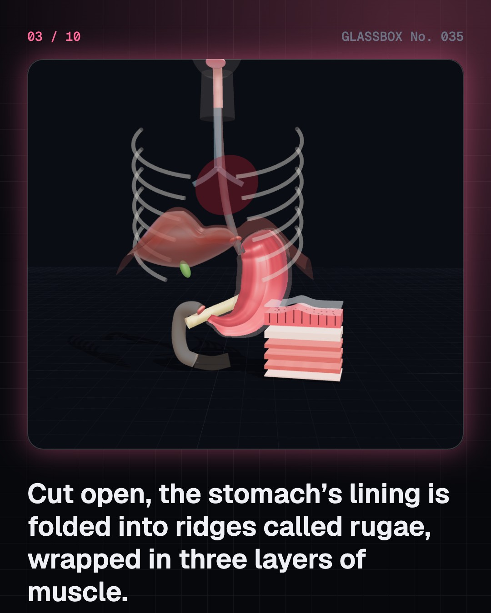
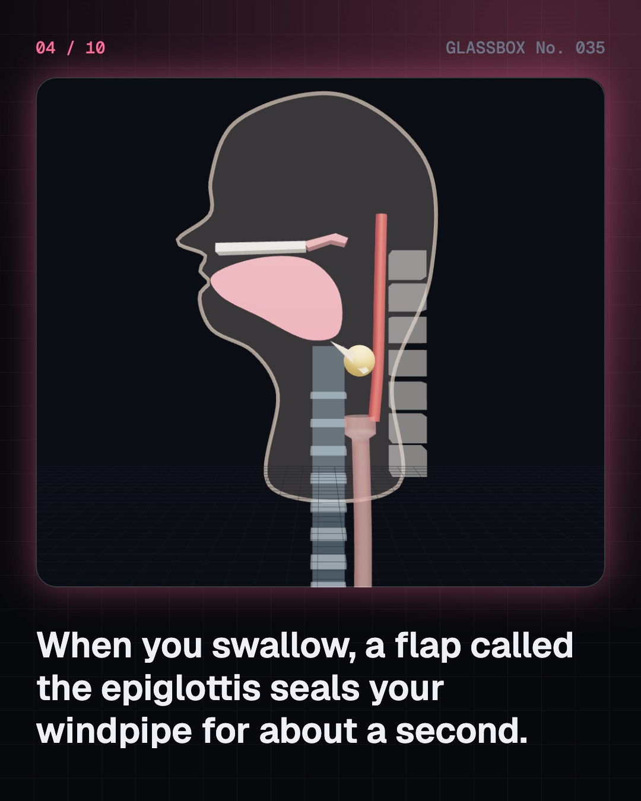

<!-- glassbox:start -->
<!-- Generated from glassbox.json by the Glassbox hub (npm run readme -- stomachclear). Edit glassbox.json, not this block. -->
<p align="center"><a href="https://glassbox.how/e/stomachclear/"></a></p>

<h1 align="center">StomachClear</h1>

<p align="center"><b>How does the stomach digest food?</b><br>Your stomach is a muscular bag of acid strong enough to dissolve meat, yet it doesn't digest itself. Swallow a bolus, cut the stomach open, watch it churn food into chyme three times a minute, and meet the germ a doctor drank to win a Nobel Prize.</p>

<p align="center"><a href="https://glassbox.how/stomachclear/"><b>▶ Play with it</b></a> &nbsp;·&nbsp; <a href="https://glassbox.how/e/stomachclear/">Read the 60-second explainer</a> &nbsp;·&nbsp; <a href="https://glassbox.how/stomachclear/glassbox/reel.mp4">Watch the 40-second video</a></p>

<p align="center">
  <a href="https://glassbox.how/e/stomachclear/"></a>
  <a href="https://glassbox.how/e/stomachclear/"></a>
  <a href="LICENSE"></a>
  <a href="LICENSE-CONTENT.md"></a>
  <a href="#privacy"></a>
</p>

## In 60 seconds

1. **A 25 cm tube and a J-shaped bag.** Food goes from the mouth down the oesophagus, about 25 cm long, through the diaphragm into the stomach, which sits under the left ribs. The stomach has a fundus, a body, an antrum and a pylorus, a ring of muscle at the exit. Its wall has a folded lining and three layers of muscle.
2. **Swallowing is a squeeze, not a slide.** Chewing mixes food with saliva, whose amylase starts on starch. When you swallow, the epiglottis seals the windpipe for about a second, then a peristaltic wave carries the bolus down in about 5 to 10 seconds. It even works upside down.
3. **Acid that doesn't burn its maker.** Parietal cells use proton pumps to make hydrochloric acid, keeping the stomach at about pH 1.5 to 3.5. Chief cells make pepsinogen, which acid turns into pepsin to cut proteins. A mucus gel full of bicarbonate keeps the lining nearly neutral; weaken it and an ulcer can form.
4. **A mill with a gatekeeper.** About three times a minute a squeeze sweeps towards the pylorus, grinding food into chyme. The pylorus lets through only bits under about 1 to 2 mm and jets the rest back. Water leaves in minutes; a meal takes about 2 to 4 hours, and fatty food the longest.
5. **Hungry, full and growling.** The empty stomach holds about 75 mL but relaxes to take 1 to 1.5 litres. Stretch receptors signal fullness up the vagus nerve, ghrelin rises before meals, and gastrin calls for more acid. Growls are gas and fluid being squeezed along.
6. **When things go wrong.** Acid slipping past a weak sphincter causes heartburn. Most ulcers are caused by the germ H. pylori, which Barry Marshall proved by drinking it in 1984; spicy food doesn't cause them. Vomiting is a protective reflex run by the brainstem. For your own health, talk to a doctor.

## Words worth knowing

| Term | Meaning |
|---|---|
| **Oesophagus** | The 25 cm muscular food pipe from the throat to the stomach. |
| **Peristalsis** | Waves of muscle squeezing that push food along the gut. |
| **Lower oesophageal sphincter** | The ring of muscle that lets food into the stomach and keeps acid out of the oesophagus. |
| **Parietal cell** | A stomach cell that makes hydrochloric acid using proton pumps (H⁺/K⁺-ATPase). |
| **Pepsin** | An enzyme, activated by acid, that breaks proteins into smaller pieces. |
| **Mucus barrier** | A gel laced with bicarbonate that protects the stomach lining from its own acid. |
| **Chyme** | The soupy mix of partly digested food and gastric juice that leaves the stomach. |
| **Pylorus** | The stomach's exit, whose sphincter lets through only small particles. |
| **Ghrelin** | The hunger hormone, made mostly by the stomach, which rises before meals. |

## A short history

**Two thousand years from a digestive fire and a cooking pot to a hole in a fur trader’s side, a doctor who drank a germ, and the hunger hormone.**

- **100 BCE** · Agni, the digestive fire (Charaka and the Ayurvedic tradition, Ancient India)
- **170** · Galen’s stomach “concocts” food (Galen of Pergamon, Pergamon and Rome)
- **1752** · A bird of prey swallows metal tubes (René-Antoine Ferchault de Réaumur, Paris)
- **1780** · Spallanzani swallows his own experiments (Lazzaro Spallanzani, Pavia)
- **1822** · A gunshot leaves a window into the stomach (Alexis St. Martin and William Beaumont, Mackinac Island, Michigan)
- **1824** · The acid is hydrochloric acid (William Prout, London)
- **1904** · Nobel Prize for the digestive glands (Ivan Pavlov, St Petersburg)
- **1957** · Light through glass fibres (Basil Hirschowitz, Ann Arbor, Michigan)

The full story, with 29 moments, charts, people and 34 sources: [glassbox.how/e/stomachclear/history](https://glassbox.how/e/stomachclear/history/). The data lives in [`history.json`](history.json).

## Video and slides

Made with the Glassbox studio from this box's storyboard (`window.glassbox.director`). Free to reuse under CC BY 4.0.

<a href="https://glassbox.how/stomachclear/glassbox/video.mp4"></a>

<p><a href="glassbox/slide-1.jpg"></a> <a href="glassbox/slide-2.jpg"></a> <a href="glassbox/slide-3.jpg"></a> <a href="glassbox/slide-4.jpg"></a></p>

| File | What | Size |
|---|---|---|
| [`glassbox/reel.mp4`](https://glassbox.how/stomachclear/glassbox/reel.mp4) | Reel / Short, with captions and soundtrack | 1080×1920 |
| [`glassbox/video.mp4`](https://glassbox.how/stomachclear/glassbox/video.mp4) | YouTube video, with captions and soundtrack | 1920×1080 |
| `glassbox/slide-1…10.jpg` | Instagram carousel | 1080×1350 |
| `glassbox/thumb.jpg` | YouTube thumbnail | 1280×720 |
| `glassbox/cover.jpg` | Share card and repo social preview | 1200×630 |
| [`glassbox/history-reel.mp4`](https://glassbox.how/stomachclear/glassbox/history-reel.mp4) | “History in 10 moments” Reel / Short | 1080×1920 |
| `glassbox/history-slide-*.jpg` | History carousel | 1080×1350 |
| `glassbox/post.json` | Post copy and schedule used by the publish kit | |

## Privacy

This box has no accounts and no ads, and it ships its own fonts and libraries. When you run it yourself it sends nothing anywhere. On glassbox.how, the site's `/bar.js` also loads Glassbox's analytics: **Google Analytics** to count visits (it asks first in the EU, UK and Switzerland, and stays off when your browser sends Global Privacy Control or Do Not Track) and **ClickTrust** to detect bots.

It remembers a few things **in your own browser only**, and never sends them anywhere:

| Browser storage key | What it holds |
|---|---|
| `stomachclear.v1` | Which chapters you have opened, your best quiz scores, and sound on or off. |

Exactly what each one sees is at [glassbox.how/privacy](https://glassbox.how/privacy/).

## Licences

- **Code:** [MIT](LICENSE). Use it, change it, ship it.
- **Explanations, text, images and videos** (`glassbox.json`, `glassbox/`): [CC BY 4.0](LICENSE-CONTENT.md). Credit “Glassbox, glassbox.how/e/stomachclear”.
- **Third-party parts** keep their own licences: [three.js](https://threejs.org) (MIT), [Geist, Instrument Serif](https://openfontlicense.org) (SIL OFL 1.1).
- The Glassbox name and logo aren't covered by either licence. See the [terms](https://glassbox.how/terms/).

Found a mistake? [Open an issue](https://github.com/bdeeps/stomachclear/issues). Corrections happen in public.
<!-- glassbox:end -->

## Run it

It's plain HTML, CSS and JavaScript. No build step and no dependencies. Run locally, it contacts no other website.

```bash
python3 -m http.server 8000
```

Three.js and the fonts ship in `vendor/` and `fonts/`, so it also works offline.

Then open http://localhost:8000.

## How it's built

| File | What |
|---|---|
| `index.html`, `css/app.css` | The page and its styles |
| `js/app.js`, `js/stage.js`, `js/ui.js`, `js/kit.js` | The shared Glassbox 3D engine: chapters, 3D stage, controls, quiz, video director |
| `js/stomach.js` | The 3D upper digestive tract (oesophagus, stomach with its regions and dynamic wall, duodenum, diaphragm, liver, ribs), the magnified wall layers and shared helpers |
| `js/chapters/*.js` | One file per chapter: the 3D model, controls, text, key terms, quiz and video scenes |
| `glassbox.json` | Title, question, explainer beats, key terms, browser storage and credits shown on glassbox.how |
| `reel` in each chapter | The storyboard the Glassbox studio records into short videos |
| `glassbox/` | The published video, slides, thumbnail and post copy |
| `fonts/`, `vendor/three/` | Self-hosted Geist and Instrument Serif (SIL OFL 1.1) and three.js (MIT) |
